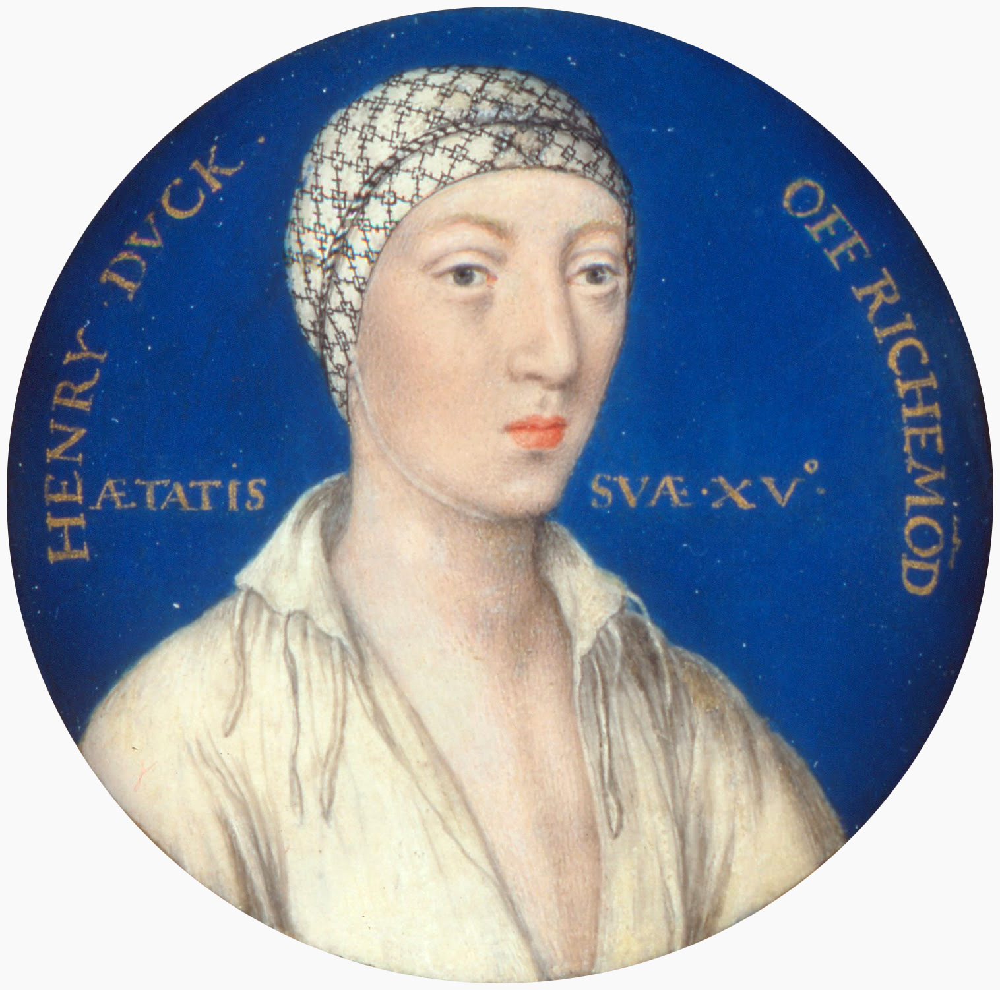

# FitzCLIM

_-_Google_Art_Project.jpg)

**[View PDF Documentation](documentation/fitzclim.pdf)**

FitzCLIM is a Common Lisp implementation of the CLIM II protocols and the
CLIM 2.2 revisions.  It is
aimed at SBCL.  The frame manager realizes the standard gadgets as native
controls.  Application panes are drawn by FitzCLIM and hold presentations.
A 3D pane is a native OpenGL child window; a pick on that pane is a Lisp
object and can run a command.

The 2D graphics protocol stays two-dimensional.  Regions, transforms,
clipping, formatted output, and output recording are a plane.  The OpenGL
pane owns its scene and its redraw.

FitzCLIM was begun for [EDEFB](https://github.com/cgore/edefb), the Elite
Dangerous Electronic Flight Bag.  It is a general toolkit, and other
programs will use it too.

FitzCLIM is a clean-room implementation.  It is not a derivative of McCLIM.

## License

3-clause BSD.  See [LICENSE.md](LICENSE.md).  Copyright (c) 2026, Christopher
Mark Gore, Soli Deo Gloria.
